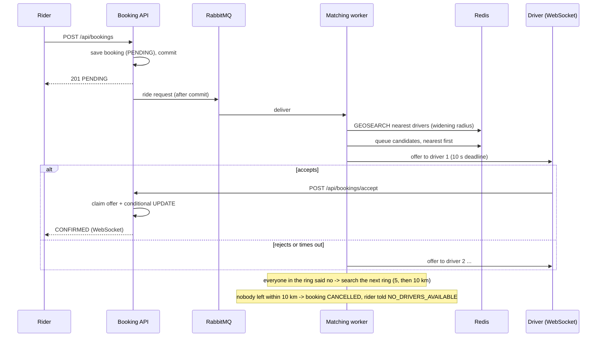

# Uber-style ride matching backend

Spring Boot service that matches a ride request with the nearest available driver.
Redis GEO finds nearby drivers, RabbitMQ keeps matching off the request path, and WebSockets push offers to drivers.

## How a ride is matched



## Run it

```
docker compose up -d        # Redis 7 + RabbitMQ (management UI on :15672)
./gradlew bootRun           # app on :8080
./gradlew test              # unit tests, no Redis/RabbitMQ needed
```

Drivers listen on `/topic/driver/{id}` over STOMP (`test.html` is a minimal client). Riders get status on `/topic/bookings/{id}`.

## Design decisions and trade-offs

**Redis GEO for driver positions**
- A GEO set is a sorted set whose score is a 52-bit geohash. `GEOSEARCH ... BYRADIUS ... WITHDIST ASC COUNT n` returns drivers in a circle, already nearest first, in one round trip.
- Cost is O(N + log M): N drivers inside the circle, M in the set. COUNT trims the result but Redis still scans the whole circle, so the radius is capped (`app.matching.max-radius-km`) rather than trusting the limit.
- Members cannot have a TTL, so a second sorted set (`driver:seen`, score = last update time) tracks presence. A sweeper removes drivers who stopped reporting, so a crashed phone never receives offers.
- Location write is `GEOADD` + `ZADD` in one pipeline.
- Distance is straight-line, not road ETA. Good enough to shortlist; a routing service would re-rank the shortlist.

**Progressive radius, nearest first**
- Search 2 km, then 5, then 10. Drivers in the closest ring that has free drivers are offered the ride first. If they all decline or time out, the search widens to the next ring and skips drivers who already had the offer (`ride:{id}:asked` set). Only after 10 km is the booking cancelled. Tight searches are cheap and give short pickup times; widening only happens when needed.
- Availability is checked with one `IN` query for the whole batch instead of one query per driver.

**One offer at a time, one arbiter**
- A candidate queue lives in Redis. Each offer has a deadline in a sorted set (`ride:offer:deadlines`).
- Accept, reject and timeout can fire together. Each calls `ZREM` on the booking's deadline; Redis returns 1 to exactly one caller, which owns the transition. No lock, and it works across several app instances.
- The timeout job polls that set. The first version scanned keys with `KEYS` and waited for expiry, which never fires (an expired key is gone from the scan) and blocks Redis.
- Second line of defence: `UPDATE ... WHERE status = 'PENDING'` makes double assignment of a booking impossible even if Redis state is wrong.
- A driver holds one pending offer at a time: before offering, `SET NX driver:{id}:offer` (with a TTL) reserves them, and anyone already reserved is skipped. On accept, a conditional `UPDATE ... WHERE isAvailable = true` on the driver row makes double assignment of a driver impossible as well. The reservation is released when the offer ends.

**RabbitMQ**
- The ride request is published after the booking transaction commits. Publishing inside the transaction let the consumer run first and fail with "booking not found".
- Publisher confirms and mandatory returns make an unrouted or rejected message visible.
- Consumer: bounded prefetch and concurrency, 3 attempts with backoff, then reject without requeue into a dead-letter queue (`ride.requests.dlq`). A poison message cannot loop forever.
- Delivery is at least once, so the consumer is idempotent: `SET NX` on `ride:{id}:matching` lets only the first delivery start matching; the guard is released if the search itself fails so a retry can start over.

**Observability** (`/actuator/prometheus`)
- `matching_geo_search_seconds`: one GEOSEARCH. `matching_geo_write_seconds`: one location update.
- `matching_candidate_search_seconds`: radius widening + availability check for one booking.
- `matching_sessions_total{result=matched|no_driver}`, `matching_offer_timeouts_total`, `matching_publish_failures_total`.
- Histograms are on, so p50/p95/p99 come from Prometheus. Use these (plus a load test) for latency claims instead of guessing.

## Known limitations

- **Publish gap:** if the app dies between the booking commit and the RabbitMQ publish, the booking stays PENDING. A transactional outbox (write the event with the booking, relay it later) closes this; the publish failure counter shows it today.
- **One GEO key:** fine for a city. For many cities, shard the key by region or geohash cell so one hot key does not carry everything.
- **Simple STOMP broker is in memory:** offers only reach drivers connected to the same instance. Scaling out needs a broker relay (e.g. RabbitMQ STOMP plugin).
- **WebSocket auth:** none yet; any client can subscribe to a driver topic. Origins are configurable (`app.websocket.allowed-origins`), not authenticated.
- **H2 by default:** switch the datasource for anything real.
- The claim-then-act sequence on accept can lose a booking if the process dies between the claim and the DB write; the offer is put back on failures it can see, not on a hard crash. A lease with a visibility timeout would cover that.

## Config

All matching tunables are in `application.properties` under `app.matching.*` (radii, candidate count, offer timeout, stale-driver age, radius cap).

## Sample driver locations

`POST /api/v1/location/driverLocation` (latitude first, then longitude; this is Delhi):

```json
[
  { "driverId": 4, "latitude": 28.60700100660324, "longitude": 77.20499955275207 },
  { "driverId": 2, "latitude": 28.613899648189545, "longitude": 77.2089993427415 },
  { "driverId": 3, "latitude": 28.61999899148941, "longitude": 77.21499902772567 }
]
```

`POST /api/v1/location/nearbyDrivers` with `{ "latitude": 28.6139, "longitude": 77.2090, "radius": 5 }` returns drivers nearest first with `distanceKm`.
